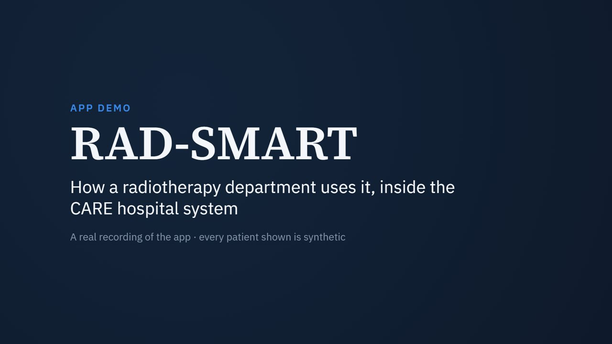
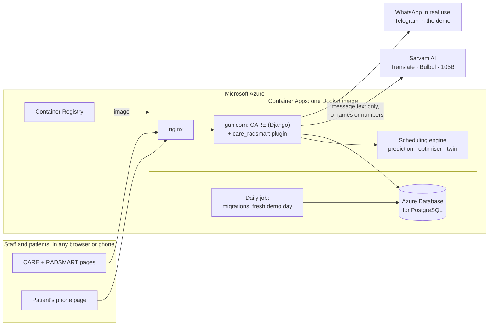

# RAD-SMART

**Radiotherapy AI-assisted Dynamic Scheduling, Machine Allocation and Resource Tracking**

[](https://radsmart.braveglacier-5f9807f7.uaenorth.azurecontainerapps.io/try/)
[](deploy/azure/Dockerfile)
[-1C5CAB)](https://github.com/ohcnetwork/care)
[](https://github.com/psraghothamrao8/RAD-SMART/actions/workflows/engine-tests.yml)
[](docs/evaluation/sarvam_evaluation.md)
[](LICENSE)

Health-a-thon 2026 · Cancer track · Use case 04: Clinic Operations & Patient Flow. Team: Dr Akshay Dinesan, Manipal (team leader, doctor partner); Abhinand T M (technical lead); P S Raghotham Rao (lead engineer); Dr Shirley Lewis Salins and Dr Umesh Velu (doctor partners).

One radiotherapy machine treats 70–90 patients a day, and one patient in ten waits more than 109 minutes. RAD-SMART is an assistive, not diagnostic, operations layer for radiotherapy departments. It predicts each session's machine-minutes, gives each course a new-start slot and a standing slot in which hard rules cannot be broken, repairs the day live when a machine breaks down, stress-tests plans in a digital twin, and explains decisions and messages patients in their own language through Sarvam AI. A person approves every change: the doctor each course, a technologist or doctor each breakdown response.

On the department's own 55 recorded days, replayed, the long wait falls from **109 to 70 minutes (−35%)**, and patients treated more than an hour late from **22% to 6%**.

| | |
|---|---|
| **Try it live** | **https://radsmart.braveglacier-5f9807f7.uaenorth.azurecontainerapps.io/try/**: one click as a doctor, reception, a technologist or a patient, with synthetic patients |
| **Watch the demo** (3¾ min, narrated, recorded on the live server) | https://psraghothamrao8.github.io/RAD-SMART/#demo · [MP4](docs/media/RAD-SMART_demo.mp4) |
| **Phase 2 submission** | [PDF](docs/Phase2_Submission.pdf) · [DOCX](docs/Phase2_Submission.docx) · [official template, PPTX](docs/RAD-SMART_Phase2_Submission.pptx) |
| **Website** | https://psraghothamrao8.github.io/RAD-SMART/ |
| **Pitch deck** | [web](https://psraghothamrao8.github.io/RAD-SMART/deck/) · [PDF](docs/deck/RAD-SMART_Pitch_Deck.pdf) |
| **User guide and demo script** | [PDF](docs/RAD-SMART_User_Guide.pdf) |
| **Research paper** (8 pages) | [PDF](docs/RAD-SMART_Research_Paper.pdf) |
| **Technical guide** | [web](https://psraghothamrao8.github.io/RAD-SMART/tech/) · [the maths, worked through](https://psraghothamrao8.github.io/RAD-SMART/tech/maths.html) |

[](https://psraghothamrao8.github.io/RAD-SMART/#demo)

## What it does

**It runs inside CARE**, the Open Healthcare Network's open-source hospital information system, as a pair of plugins with a **RADSMART** button on the patient's visit page (`app/`, see [`app/README.md`](app/README.md)). CARE's own code is unchanged.

| Who | What they do in RAD-SMART |
|---|---|
| Doctor | Enters a course and the patient's preferred part of the day; approves its first day (before 17:00) and one standing daily time; asks for a plain-words explanation |
| Technologist | Runs the day board (arrived, in room, out) with a live queue: who to call next, who is late, taking a ready patient in out of turn with a one-tap reason; reports a breakdown and approves the re-plan; sends patients' messages |
| Reception | Checks patients in by scanning the QR code on their phone |
| Patient and family | One private phone page, no app and no login: today's time, changes, messages with voice notes, the check-in code, four reply buttons, a morning, afternoon or evening preference |
| Head of department | Insights: are long waits falling? |

**The patient's preferred time.** A patient can ask for the morning (08:30–12:00), afternoon or evening (to 21:00). A new patient often starts wherever there is room; as other courses finish, RAD-SMART looks for a free slot inside the preferred part of the day, on every remaining treatment day, that keeps every rule and the time kept for new starts, and offers it to staff. Staff ask the patient, and nothing changes until they approve.

**Patients come early and late.** The day board shows who to call next: the first patient in the plan's order who is here, so the machine never waits for someone who has not come. A technologist can take anyone in at any time. RAD-SMART asks why with one tap, reminds them of anything to check (bladder preparation, senior staff, a shared ABC unit or breast board), and records it, but never blocks them.

**Patients and Sarvam AI.** After each approval RAD-SMART drafts the patient's message in Kannada, Malayalam, Hindi or Konkani (Tulu speakers read Kannada script) with Sarvam Translate, and a voice note with Bulbul v3; a technologist opens it in WhatsApp and presses send. Sarvam-105B explains a proposed time in plain words. A translation that changes a time, or an explanation that invents one, is thrown away; without Sarvam everything works in English. In our evaluation ([`docs/evaluation/`](docs/evaluation/sarvam_evaluation.md)), 112 of 112 translations in four languages kept every time, and 20 of 20 explanations were accepted.

## Architecture and deployment



| Layer | Technology |
|---|---|
| Hospital system | [CARE](https://github.com/ohcnetwork/care) (Django, PostgreSQL) and [care_fe](https://github.com/ohcnetwork/care_fe) (React), at pinned versions |
| RAD-SMART backend | Django plugin `care_radsmart`: models, a role-checked REST API, the Sarvam layer, the patient page, the Telegram demo channel |
| RAD-SMART frontend | React and TypeScript plugin `care_radsmart_fe`, loaded by CARE through Module Federation |
| Engine | Python: gradient boosting (scikit-learn) for session minutes; mixed-integer optimisation (SciPy with HiGHS); a Monte Carlo digital twin; an independent rule checker |
| Language AI | Sarvam Translate, Bulbul v3 (voice) and Sarvam-105B (explanations), each output checked |
| Packaging | One Docker image built on CARE's production image, with nginx and gunicorn |
| Hosting | Azure Container Apps (HTTPS, scale to zero), Azure Database for PostgreSQL with daily backups, Azure Container Registry, a daily Container Apps job |
| Operations | [`deploy/azure/deploy.sh`](deploy/azure/deploy.sh): one script creates, builds, migrates, deploys and checks everything |

**The live server** runs in demonstration mode: synthetic patients, one-click roles with no password, and a fresh day every morning at 05:30 IST. In real use, staff sign in to CARE with their own accounts and RAD-SMART checks the role at every step. Moving to the pilot is configuration, not new code: the same image runs with demonstration mode off, on the hospital's own server (Docker Compose, beside its CARE) or in an Indian Azure region. How it is hosted, and what each piece costs, is in [`deploy/azure/`](deploy/azure/README.md).

## Run it yourself

```bash
# the whole development environment: CARE at pinned versions, both plugins, synthetic data
bash workspace/restore.sh

# deploy to Azure (after az login, with the development environment running)
bash deploy/azure/deploy.sh all

# the plugin's 37 automated tests, inside the running CARE backend
docker exec care_radsmart_dev-backend-1 python manage.py test care_radsmart.tests

# the engine's quick checks, also run by GitHub on every push
cd poc && pip install -r requirements.txt && python -m unittest discover -s tests -v
```

New to Docker or Azure? [`deploy/HOSTING_GUIDE.md`](deploy/HOSTING_GUIDE.md) explains every command, from an empty PC to the live server.

Details: [`workspace/README.md`](workspace/README.md) (development), [`app/README.md`](app/README.md) (the plugins, roles and API), [`poc/README.md`](poc/README.md) (the engine and its experiments).

## What is in this folder

| Path | What it is |
|---|---|
| `docs/Phase2_Submission.pdf` (`.docx`, `.md`) | The Phase 2 final submission: team and problem, users and solution, the working MVP and AI approach, build sprint progress, evaluation, safety, deployment and costs, next steps, with a short version of each section |
| `docs/evaluation/` | The Sarvam AI evaluation (`sarvam_evaluation.md`), its raw results, and every translation with its back-translation for native speakers to rate (`sarvam_translations_for_rating.csv`). Rerun with `python tools/evaluate_sarvam.py --env-file <file with SARVAM_API_KEY>`; it fetches only missing results |
| `docs/RAD-SMART_User_Guide.pdf` (`.docx`, `.md`) | How to use the app (doctor and technologist, step by step with screenshots) and how to show it: setup checklist, a 5-minute demo script, fallbacks and likely questions |
| `docs/media/` | The demo video (`RAD-SMART_demo.mp4`) and its poster image |
| `docs/RAD-SMART_Research_Paper.pdf` (`.docx`, `.md`) | Eight-page research paper: the problem, the method, results on both datasets, limitations |
| `docs/RAD-SMART_Research_Report.pdf` (`.docx`, `.md`) | Full research report: problem, evidence, five approaches and the choice, solution design, PoC results, KPIs, implementation plan, pilot, requirements, budget, risks, references |
| `docs/RAD-SMART_Impact_Analysis.pdf` (`.docx`, `.md`) | Four pages: how much RAD-SMART improves waiting, with and without it, on the original dataset (the department's records) and on the simulated dataset, and what it costs |
| `app/` | The application: a backend plugin (`care_radsmart`, Django) and a frontend plugin (`care_radsmart_fe`, React) for CARE. Setup, roles, permissions and the API are in `app/README.md` |
| `docs/Round1_Submission_Kit.pdf` (`.docx`, `.md`) | Ready-to-paste answers for the five Round 1 sections, deck outline, video script, likely jury questions, checklist, and links to the published deck and website |
| `docs/figures/` | All figures (architecture, daily loop, PoC charts, screenshots of the CARE application with synthetic patients) |
| `docs/figures-src/` | HTML sources of the architecture and daily-loop diagrams |
| `poc/` | The scheduling engine in Python, its experiments on synthetic patients and its tests, with the digital twin calibrated on aggregates of the department's records (see `poc/README.md`) |
| `tools/analyse_department_data.py` | Summarises the department's anonymised spreadsheet into the aggregates the twin uses: `python tools/analyse_department_data.py "<file>.xlsx"`. The spreadsheet is never committed |
| `tools/build_docs.py` | Rebuilds the DOCX and PDF from the Markdown: `python tools/build_docs.py docs/<file>.md` |
| `docs/index.html` | The project website (the prototype link), served by GitHub Pages. Plain HTML: edit it directly |
| `docs/deck/` | Pitch deck: `RAD-SMART_Pitch_Deck.pdf`, the web version `index.html`, and the 12 slide sources in `src/` |
| `tools/demo-video/` | How the demo video is made: a script drives the app in headless Chrome and records it, and a Remotion project adds titles, captions and the pointer (see its README) |
| `tools/build_deck.py` | Rebuilds the web deck and its PDF from `docs/deck/src/` (needs Google Chrome): `python tools/build_deck.py` |
| `workspace/` | Rebuilds the whole development environment from this repository: `bash workspace/restore.sh` fetches CARE at the pinned commits, wires in the plugins, starts Docker and loads the synthetic data (see `workspace/README.md`) |
| `deploy/azure/` | The deployment: the Dockerfile, nginx and settings, and `deploy.sh`, which builds the image and runs RAD-SMART on Microsoft Azure (Container Apps, PostgreSQL, Container Registry, a daily job), with cost guards (see `deploy/azure/README.md`) |
| `.github/workflows/` | GitHub Actions: the engine's tests on every push |

## Key dates

- Round 1 closed on 25 Sep 2026, and we were shortlisted.
- The build sprint runs 5 Oct – 8 Nov, and the Top 30 are announced by 14 Nov.
- The grand finale is at IIT Bombay on 28 Nov 2026.

## What the department's records show

The department shared anonymised arrival and treatment records for 55 days, October–December 2024 (3,137 patient-days). We use them only as aggregates.

- The median wait from arrival to treatment is 34 minutes, but one patient in ten waits more than 109 minutes. 22% are treated more than an hour after their appointment, and only 29% within 15 minutes of it.
- Waits build through the day, from about 19 minutes for patients arriving before 10:00 to about 66 minutes after 19:00, and evening patients now come about 32 minutes early.

## With and without RAD-SMART

The impact analysis (`docs/RAD-SMART_Impact_Analysis.pdf`) keeps the two datasets apart.

| Dataset | 90th-percentile wait, without → with | Treated more than 1 hour late, without → with |
|---|---|---|
| Original: the department's 55 recorded days, re-planned in the twin | 108.6 → **70.4 min** (−35%) | 22.2% → **5.7%** |
| Simulated: 12 weeks of synthetic courses with standing slots | 81.6 → **49.3 min** (−40%) | 18.6% → **3.6%** |

The price, over the 12 weeks: the last patient finishes at about 00:07 instead of 21:55, one new start in five begins a little later (0.4 working days on average), and a time the patient asks for is kept less often.

## Headline PoC results (synthetic patients, 300 simulated days)

Tested under the department's own rules (its answers of 21 September and 24 October 2026) on an 87-patient day from 08:30 to 01:00, 10 patients more than the busiest recorded day, in a digital twin calibrated on the records. Against the department's busiest recorded days (70–77 patients):

- The 90th-percentile wait from arrival to the treatment room falls from 130 to 76 minutes, and the share treated more than an hour after their time from 27% to 6%. The share treated within ±15 minutes rises from 30% to 53%.
- The median wait stays about the same (36 against 38 minutes), because patients are asked to arrive 20 minutes early (45 for pelvic patients) to prepare. Waits no longer build up in the evening: about 36 minutes for morning and evening arrivals alike, against 19 and 66 in the records.
- The independent checker found all 8 hard rules met, including new starts by 17:00, MHRC patients on the 17:00 bus and public-transport patients home by 21:00.
- With live re-planning under the department's downtime rules of 24 October, the median wait after a 45-minute fault is 37 minutes instead of 53 without re-planning: nobody is sent home, and 1 new start moves to the next day. After a 150-minute fault it is 39 minutes instead of 104: one patient who had not left home is sent back (the fraction is added at the end of the course) and 2 new starts move to the next day. Each re-plan takes 10–14 seconds.
- Two-machine new-start planning around a TBI course keeps peak load at 98–99%, instead of 154% on one machine.

The pilot's primary KPI is a 90th-percentile wait at least 25% lower than the records' 109 minutes.

## Data

The prototype's patients are synthetic. `tools/analyse_department_data.py` summarises the department's anonymised spreadsheet into aggregates only (`poc/data/department_profile.json`). The spreadsheet itself is excluded by `.gitignore` and never committed.

## Licence

MIT, the same licence as CARE: see [`LICENSE`](LICENSE). RAD-SMART is assistive, not diagnostic: it plans when and on which machine a session takes place, and clinicians decide everything else.
