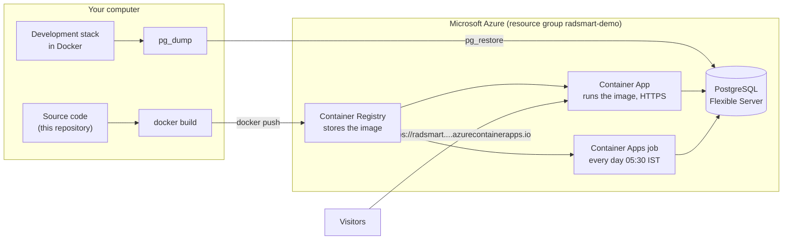

# How RAD-SMART is hosted: every command, explained

This guide shows how RAD-SMART goes from source code to a live website on Microsoft Azure, and how to do it again from nothing. Every command is shown with what it does. You do not need to type most of them yourself: [`azure/deploy.sh`](azure/deploy.sh) runs them in the right order. They are written out here so you can learn what happens and fix it when something breaks.

- [The short version](#the-short-version)
- [1. The big picture](#1-the-big-picture)
- [2. Accounts and tools](#2-accounts-and-tools)
- [3. Get the code and run it on your computer](#3-get-the-code-and-run-it-on-your-computer)
- [4. Secrets](#4-secrets)
- [5. Sign in to Azure](#5-sign-in-to-azure)
- [6. What `deploy.sh all` does, step by step](#6-what-deploysh-all-does-step-by-step)
- [7. Inside the container](#7-inside-the-container)
- [8. Day to day](#8-day-to-day)
- [9. Keeping it free](#9-keeping-it-free)
- [10. The GitHub side](#10-the-github-side)
- [11. Problems we hit, and the fixes](#11-problems-we-hit-and-the-fixes)
- [12. From demonstration to a real pilot](#12-from-demonstration-to-a-real-pilot)

## The short version

On a Windows PC with Git, Docker Desktop, Node.js, Python and the Azure CLI installed, in **Git Bash**:

```bash
git clone https://github.com/psraghothamrao8/RAD-SMART.git     # 1. get the code
cd RAD-SMART
SARVAM_API_KEY=... bash workspace/restore.sh                   # 2. CARE + RAD-SMART running on this computer, in Docker
az login                                                       # 3. sign in to Azure
bash deploy/azure/deploy.sh all                                # 4. create everything on Azure and deploy
bash deploy/azure/deploy.sh status                             # 5. check: address, replicas, hours used
```

After a code change, update the live server with:

```bash
bash deploy/azure/deploy.sh build job reseed push
```

The rest of this guide explains what those five lines do.

## 1. The big picture



**Words you will meet:**

| Word | Meaning |
|---|---|
| **Docker image** | A packaged, read-only copy of an application and everything it needs (Python, libraries, nginx, our code). Built once from a `Dockerfile`. |
| **Container** | A running copy of an image. You can run the same image on a laptop, a hospital server or Azure. |
| **Dockerfile** | The recipe for an image: start from this base, install these packages, copy these files, run this command. |
| **Registry** | A store for images, like GitHub is for code. Ours is Azure Container Registry. |
| **Resource group** | A folder in Azure. Everything for RAD-SMART is in `radsmart-demo`, so deleting that folder deletes everything. |
| **Container Apps** | Azure's service that runs a container for you, gives it an HTTPS address, restarts it if it crashes, and can scale it to zero when idle. |
| **Container Apps environment** | The private network the app and the job share. |
| **Container Apps job** | A container that runs to completion on a schedule, like a cron job. |
| **PostgreSQL Flexible Server** | A database server that Azure runs, backs up and patches for you. |
| **Managed identity** | An identity Azure gives the app itself, so it can call Azure's API without a password. The cost guard uses it. |
| **Secret** | A password or key given to the app at run time, never put in the image or the code. |

**What runs where:**

| Piece | Azure service | Size |
|---|---|---|
| CARE (Django, gunicorn), the RAD-SMART plugin and engine, nginx, Redis, both web frontends | Container Apps, one container | 0.5 vCPU, 1 GiB memory, 0 to 1 copies |
| The database | Azure Database for PostgreSQL Flexible Server | Burstable B1ms (1 vCore, 2 GiB), 32 GB, 7-day backups |
| The images | Azure Container Registry | Standard; the newest three images are kept |
| The daily fresh demonstration day and database migrations | Container Apps job | runs about 3 minutes a day |

## 2. Accounts and tools

**Accounts**

| Account | Why | Where |
|---|---|---|
| GitHub | the code, the website (GitHub Pages) and the automatic tests | github.com |
| Azure for Students | the hosting, free with a university email | azure.microsoft.com/free/students |
| Sarvam AI (optional) | translation, voice notes and explanations | dashboard.sarvam.ai; without a key everything works in English |
| Telegram bot (optional) | showing messages arriving on a phone in the demonstration | @BotFather in Telegram, see [Secrets](#4-secrets) |

**Tools on Windows.** These can be installed from PowerShell with `winget`:

```powershell
winget install Git.Git                     # Git and Git Bash: the scripts are bash scripts
winget install Docker.DockerDesktop        # Docker: builds and runs containers (restart Windows after)
winget install OpenJS.NodeJS.LTS           # Node.js 20+: builds the React frontends
winget install Python.Python.3.12          # Python: the engine, the tests and the document builders
winget install Microsoft.AzureCLI          # az: the Azure command line
winget install GitHub.cli                  # gh: the GitHub command line (optional)
```

Check them in Git Bash:

```bash
git --version; docker --version; node --version; python --version; az version; gh --version
```

## 3. Get the code and run it on your computer

```bash
git clone https://github.com/psraghothamrao8/RAD-SMART.git
cd RAD-SMART
SARVAM_API_KEY=your-key bash workspace/restore.sh
```

- `git clone` downloads the repository.
- `restore.sh` builds the whole development environment ([`workspace/README.md`](../workspace/README.md)). It:
  1. clones CARE's backend, CARE's frontend and care_scaffold into `../care-workspace/scaffold`, at the exact commits written in [`workspace/pins.env`](../workspace/pins.env). Pinning means it builds the same way next year, even after CARE changes;
  2. writes the configuration and puts your keys in `.agent/.env`, which Git ignores;
  3. runs `docker compose up`, which starts five containers: the backend, Celery, PostgreSQL, Redis and MinIO;
  4. loads CARE's test users and facilities, and the synthetic RAD-SMART patients.

The deployment needs this local stack: it prepares the first database in it, then uploads it.

Useful Docker commands for looking around:

```bash
docker ps                                              # which containers are running
docker logs care_radsmart_dev-backend-1 --tail 50      # the backend's last 50 log lines
docker exec -it care_radsmart_dev-backend-1 bash       # a shell inside the backend container
docker exec care_radsmart_dev-backend-1 python manage.py test care_radsmart.tests   # the plugin's 37 tests
docker images                                          # images on this computer
docker system df                                       # how much disk Docker uses
```

## 4. Secrets

Secrets never go into Git. They live in the CARE workspace's `.agent/` folder, which Git ignores:

| File | What is in it | Made by |
|---|---|---|
| `.agent/.env` | `SARVAM_API_KEY`, `RADSMART_TELEGRAM_TOKEN`, `RADSMART_TELEGRAM_SECRET` | you, through `restore.sh` |
| `.agent/azure.env` | the database password, Django's secret key, the sign-in (JWT) signing key, the demonstration facility | `deploy.sh`, the first time it runs |
| `.agent/azure-logins.txt` | a new random password for every CARE user on the server | `deploy.sh init` |

**A Telegram bot, for the demonstration only:**
1. In Telegram, open **@BotFather**, send `/newbot`, choose a name and a username ending in `bot`. BotFather replies with the bot's token.
2. Make a random secret that Telegram will send with every call, so the server knows the call is really from Telegram:

   ```bash
   openssl rand -hex 32
   ```
3. Give both to `restore.sh`, which adds them to `.agent/.env` and keeps your other keys:

   ```bash
   RADSMART_TELEGRAM_TOKEN=<token> RADSMART_TELEGRAM_SECRET=<secret> bash workspace/restore.sh
   ```

On Azure, `deploy.sh` stores each secret as a **Container Apps secret** and passes it to the app as an environment variable (`DATABASE_URL=secretref:database-url`). The secret is never in the image, the code or the logs.

## 5. Sign in to Azure

```bash
az login                                   # opens the browser to sign in
az account show -o table                   # which subscription is active
az account list -o table                   # all your subscriptions
az account set --subscription "<name or id>"   # choose the Azure for Students one
```

Everything `deploy.sh` creates goes into this subscription.

## 6. What `deploy.sh all` does, step by step

`bash deploy/azure/deploy.sh all` runs seven steps: **setup, create, build, init, push, webhook, job**. Each can also be run on its own, for example `bash deploy/azure/deploy.sh status`. Names can be changed with environment variables: `RG` (resource group), `LOC` (region), `APP`, `JOB`, `CAE` (environment).

The script begins by working out names that must be unique across all of Azure from your subscription id:

```bash
SUB_ID="$(az account show --query id -o tsv)"          # your subscription id
SUFFIX="$(printf '%s' "$SUB_ID" | tr -d '-' | cut -c1-6)"   # its first six characters
ACR="radsmart$SUFFIX"                                  # registry name, e.g. radsmartabc123 (yours will differ)
PG="radsmart-db-$SUFFIX"                               # database server name
```

`--query` picks one field out of Azure's JSON answer, and `-o tsv` prints it as plain text.

### Step `setup`: prepare a new subscription (once)

```bash
az extension add -n containerapp
az provider register -n Microsoft.App --wait
az provider register -n Microsoft.ContainerRegistry --wait
az provider register -n Microsoft.DBforPostgreSQL --wait
```

- `az extension add` installs the `az containerapp` commands, which are an extension to the Azure CLI.
- `az provider register` switches on a kind of resource for the subscription. A new subscription must allow Container Apps, registries and PostgreSQL once before it can create them. `--wait` waits until it is done.

### Step `create`: the Azure resources (once)

**First, the secrets** are generated into `.agent/azure.env`, if they are not there yet:

```bash
openssl rand -hex 16                       # the database password (with a fixed prefix)
openssl rand -base64 48                    # Django's SECRET_KEY, which signs cookies and tokens
docker run --rm --entrypoint python <care image> -c \
  'from care.utils.jwks.generate_jwk import generate_encoded_jwks; print(generate_encoded_jwks())'
                                           # CARE's sign-in key pair, made with CARE's own code
```

**The resource group, the folder for everything:**

```bash
az group create -n radsmart-demo -l uaenorth
```

`-l uaenorth` is the region. Azure for Students allows only some regions, and Container Apps was not offered to it in Central India.

**The container registry:**

```bash
az acr create -g radsmart-demo -n radsmartabc123 -l uaenorth --sku Standard --admin-enabled true
```

| Option | Meaning |
|---|---|
| `-g` | the resource group |
| `-n` | the name, which must be unique in Azure; the image's address becomes `radsmartabc123.azurecr.io/radsmart:<tag>` |
| `--sku Standard` | the size; one Standard registry is free for 12 months on Azure for Students |
| `--admin-enabled true` | a username and password, which the Container App uses to pull images |

**The database:**

```bash
az postgres flexible-server create -g radsmart-demo -n radsmart-db-abc123 -l uaenorth \
  --tier Burstable --sku-name Standard_B1ms \
  --storage-size 32 --storage-type Premium_LRS --storage-auto-grow Disabled --version 17 \
  --zonal-resiliency Disabled --backup-retention 7 --geo-redundant-backup Disabled \
  --admin-user careadmin --admin-password "<password>" --public-access 0.0.0.0 --yes
```

| Option | Meaning |
|---|---|
| `--tier Burstable --sku-name Standard_B1ms` | the smallest server: 1 vCore, 2 GiB; 750 hours a month are free for 12 months |
| `--storage-size 32 --storage-type Premium_LRS` | 32 GB of SSD, the free amount |
| `--storage-auto-grow Disabled` | never grow by itself, so it never starts costing |
| `--version 17` | PostgreSQL 17 |
| `--zonal-resiliency Disabled`, `--geo-redundant-backup Disabled` | no standby copy and no backup in another region; both are billed |
| `--backup-retention 7` | automatic daily backups, kept for 7 days |
| `--admin-user`, `--admin-password` | the database's administrator |
| `--public-access 0.0.0.0` | a firewall rule that lets other Azure services in (our app) and nobody else |

Then:

```bash
az postgres flexible-server parameter set -g radsmart-demo -s radsmart-db-abc123 -n azure.extensions -v PG_TRGM
az postgres flexible-server db create -g radsmart-demo -s radsmart-db-abc123 -n care
```

- The first allows the `pg_trgm` extension, which CARE's text search needs. Azure allows extensions only from a list.
- The second creates the empty database `care`.

**The Container Apps environment:**

```bash
az rest --method put \
  --url "https://management.azure.com/subscriptions/<sub id>/resourceGroups/radsmart-demo/providers/Microsoft.App/managedEnvironments/radsmart-env?api-version=2026-07-01" \
  --body '{"location": "uaenorth", "properties": {"environmentMode": "WorkloadProfiles", "zoneRedundant": false,
           "workloadProfiles": [{"name": "Consumption", "workloadProfileType": "Consumption"}]}}'
```

`az rest` sends a request straight to Azure's API. Normally `az containerapp env create` would do this, but since late 2026 that command makes an "Express" environment, which cannot run jobs or give the app an identity, and we need both (see [Problems](#11-problems-we-hit-and-the-fixes)). The body asks for:
- **workload profiles mode**, with only the **Consumption** profile: you pay per second of use, which falls inside the free grant, and there is no plan fee;
- **no logs destination**, so no Log Analytics workspace, which would be billed.

The script then waits until the environment is ready:

```bash
az containerapp env show -g radsmart-demo -n radsmart-env --query properties.provisioningState -o tsv   # until "Succeeded"
```

### Step `build`: the Docker image, on your computer

**1. CARE's own production image, once:**

```bash
git -C ../care-workspace/scaffold/care archive --format=tar <CARE commit> |
  docker build -f docker/prod.Dockerfile --target runtime --build-arg APP_VERSION=<short commit> -t radsmart-care-base:<short commit> -
```

- `git archive` exports exactly that commit of CARE as a tar file, with no local files or keys.
- `docker build ... -` reads it as the build context and builds CARE's own production `Dockerfile`, which the CARE team maintains. `--target runtime` builds only its final stage, and `-t` names the image.

**2. Clean sources into a build folder, `deploy/azure/.build/`:**

```bash
git -C ../care-workspace/scaffold/care_fe archive --format=tar <care_fe commit> | tar -C .build/care_fe -xf -
(cd app/care_radsmart_fe && npm run build -- --base /plugins/radsmart/ --outDir <.build/www/plugins/radsmart> --emptyOutDir)
tar -C poc --exclude=__pycache__ -cf - pyproject.toml radsmart data | tar -C .build/engine -xf -
tar -C app/care_radsmart --exclude=__pycache__ --exclude=tests -cf - setup.py MANIFEST.in README.md care_radsmart | tar -C .build/plugin -xf -
cp deploy/azure/{Dockerfile,nginx.conf,entrypoint.sh,guard.py,settings.py} .build/
sed -i 's/\r$//' .build/{nginx.conf,entrypoint.sh,guard.py,settings.py}
```

- The first line exports CARE's frontend source; it is built inside Docker, on Linux.
- `npm run build` builds the RAD-SMART frontend plugin with Vite, to be served from `/plugins/radsmart/`.
- The `tar | tar` pairs copy the engine and the backend plugin without Python caches and tests.
- `sed 's/\r$//'` removes Windows line endings (CRLF), which break Linux scripts.

**3. The final image:**

```bash
docker build --build-arg BASE=radsmart-care-base:<short commit> --build-arg PUBLIC_URL=https://<app address> \
  -t radsmartabc123.azurecr.io/radsmart:20261026-1530 .build
```

- `--build-arg` passes values into the `Dockerfile`.
- The tag is the date and time, so every release has its own name, and an old one can be run again. The tag is kept in `deploy/azure/.tag`.

What the `Dockerfile` does is in [section 7](#7-inside-the-container).

### Step `init`: the first database

The database is prepared in the local stack, then copied to Azure. That is faster than building it over the internet, and the server never has to run CARE's set-up commands.

```bash
docker exec care_radsmart_dev-db-1 sh -c 'dropdb -U "$POSTGRES_USER" --if-exists care_azure && createdb -U "$POSTGRES_USER" care_azure'
```

This makes a separate, empty database `care_azure` beside the development one, so development data is untouched.

The next commands run inside the local backend container, pointed at that copy (`docker exec -e DATABASE_URL=.../care_azure ...`):

```bash
python manage.py migrate --noinput                     # create every table: CARE's and the plugin's
python manage.py load_fixtures                         # CARE's sample users, facilities and patients
python manage.py radsmart_demo --facility <id> --user care-doctor --census 60    # the synthetic radiotherapy department
python manage.py radsmart_sarvam --export /tmp/radsmart-answers.jsonl            # (on the development database)
python manage.py radsmart_sarvam --import /tmp/radsmart-answers.jsonl            # Sarvam answers already paid for
python manage.py shell < deploy/azure/site.py          # a new random password for every user
```

The passwords go to `.agent/azure-logins.txt`, because CARE's sample password is public.

**Upload, the `upload` step:**

```bash
curl -fsS https://api.ipify.org                       # this computer's public IP address
az postgres flexible-server firewall-rule create -g radsmart-demo -s radsmart-db-abc123 -n deploy-local \
  --start-ip-address <ip> --end-ip-address <ip>          # let only this computer in, for now
docker exec care_radsmart_dev-db-1 pg_dump -U <user> -Fc -d care_azure -f /tmp/care_azure.dump
docker exec care_radsmart_dev-db-1 pg_restore --clean --if-exists --no-owner --no-acl --no-comments \
  -d "postgres://careadmin:<password>@radsmart-db-abc123.postgres.database.azure.com:5432/care?sslmode=require" /tmp/care_azure.dump
az postgres flexible-server firewall-rule delete -g radsmart-demo -s radsmart-db-abc123 -n deploy-local --yes
```

| Command | What it does |
|---|---|
| `pg_dump -Fc` | saves the whole database into one compressed file (custom format) |
| `pg_restore --clean --if-exists` | loads it into Azure, replacing what is there |
| `--no-owner --no-acl` | skips local user names and permissions, which do not exist on Azure |
| `sslmode=require` | the connection to Azure is encrypted |
| `firewall-rule create` / `delete` | opens the database to your IP address only while uploading, then closes it again |

The local copy is then dropped, and its Redis cache cleared.

### Step `push`: the image into the registry, and the app

```bash
az acr login -n radsmartabc123                          # let local Docker push to the registry
docker push radsmartabc123.azurecr.io/radsmart:<tag>    # upload the image
```

**The first time, the app is created:**

```bash
az containerapp create -g radsmart-demo -n radsmart --environment radsmart-env --workload-profile-name Consumption \
  --image radsmartabc123.azurecr.io/radsmart:<tag> \
  --registry-server radsmartabc123.azurecr.io --registry-username radsmartabc123 --registry-password <registry password> \
  --ingress external --target-port 8080 --transport auto \
  --cpu 0.5 --memory 1.0Gi --min-replicas 0 --max-replicas 1 --system-assigned \
  --secrets database-url=<...> django-secret-key=<...> jwks=<...> sarvam-api-key=<...> \
  --env-vars DATABASE_URL=secretref:database-url DJANGO_SECRET_KEY=secretref:django-secret-key ... RADSMART_PUBLIC_URL=https://<address>
```

| Option | Meaning |
|---|---|
| `--image`, `--registry-*` | which image to run, and how to pull it from the private registry |
| `--ingress external` | reachable from the internet; Azure gives it an `https://` address and certificate |
| `--target-port 8080` | the port nginx listens on inside the container |
| `--cpu 0.5 --memory 1.0Gi` | the size of each copy |
| `--min-replicas 0` | scale to zero: no copy runs when nobody visits, so no cost; the next visit starts one |
| `--max-replicas 1` | never more than one copy |
| `--system-assigned` | gives the app a managed identity, which the cost guard uses |
| `--secrets name=value` | stores secrets in the app |
| `--env-vars NAME=secretref:name` | passes a secret to the container as an environment variable |
| `--env-vars NAME=value` | ordinary settings: allowed host names, the public address, the Sarvam limits, demonstration mode |

The app's identity may change only this app's own settings, so the guard can close the app's door:

```bash
az role assignment create --assignee-object-id <app identity> --assignee-principal-type ServicePrincipal \
  --role Contributor --scope /subscriptions/<sub id>/resourceGroups/radsmart-demo/providers/Microsoft.App/containerApps/radsmart
```

**Later times, the app is updated:**

```bash
az containerapp secret set -g radsmart-demo -n radsmart --secrets <...>
az containerapp update -g radsmart-demo -n radsmart --image radsmartabc123.azurecr.io/radsmart:<new tag> --set-env-vars <...>
```

Container Apps starts a new **revision** with the new image, sends traffic to it once it answers, and stops the old one. Visitors never see a half-updated app.

**Housekeeping:** only the newest three images are kept, so the registry stays small.

```bash
az acr repository show-tags -n radsmartabc123 --repository radsmart --orderby time_desc -o tsv   # list, newest first
az acr repository delete -n radsmartabc123 --image radsmart:<old tag> --yes                     # delete an old one
```

### Step `webhook`: Telegram

```bash
docker exec care_radsmart_dev-backend-1 python manage.py radsmart_telegram --webhook https://<app address>
```

This tells Telegram to send the bot's messages to `https://<app address>/api/care_radsmart/telegram/`, with the secret on every call. It calls Telegram's `setWebhook` API. Run it again whenever the address changes.

### Step `job`: the daily job

```bash
az containerapp job create -g radsmart-demo -n radsmart-reseed --environment radsmart-env --workload-profile-name Consumption \
  --image radsmartabc123.azurecr.io/radsmart:<tag> --registry-server ... \
  --trigger-type Schedule --cron-expression "0 0 * * *" \
  --replica-timeout 1800 --replica-retry-limit 0 --parallelism 1 --replica-completion-count 1 \
  --cpu 0.5 --memory 1.0Gi --mi-system-assigned \
  --secrets <...> --env-vars <...> --args reseed
```

| Option | Meaning |
|---|---|
| `--trigger-type Schedule --cron-expression "0 0 * * *"` | run every day at 00:00 UTC, 05:30 in India. Cron fields: minute, hour, day of month, month, day of week |
| `--replica-timeout 1800` | stop it if it runs longer than 30 minutes |
| `--replica-retry-limit 0` | do not retry a failed run; the next day's run tries again |
| `--args reseed` | the same image, started with the argument `reseed`; `entrypoint.sh` then migrates the database, makes a fresh demonstration day and runs the cost guard's check |
| `--mi-system-assigned` | an identity for the job, so it can reopen the app after a pause by the guard |

The job uses the **same image** as the app. That is why after a code change the order is `build job reseed push`: the job migrates the database to the new tables before the new app code needs them.

## 7. Inside the container

The [`Dockerfile`](azure/Dockerfile) has two stages. A **multi-stage build** uses one stage to build something and copies only the result into the final image, so build tools do not end up in it.

| Lines | What they do |
|---|---|
| `FROM node:22-bookworm-slim AS care-fe` ... `npm run build` | **Stage 1:** builds CARE's React frontend on Linux. `REACT_CARE_API_URL=""` makes it call the API on the same address it is served from. |
| `FROM ${BASE}` | **Stage 2** starts from CARE's own production image: Python, Django, gunicorn and CARE. |
| `apt-get install nginx redis-server` | adds the web server and the cache |
| `COPY engine/ ...`, `COPY plugin/ ...`, `pip install -e ...` | adds and installs the scheduling engine and the RAD-SMART backend plugin |
| `COPY settings.py`, `nginx.conf`, `entrypoint.sh`, `guard.py` | our configuration and start-up script |
| `COPY --from=care-fe ... /srv/www/`, `COPY www/ /srv/www/` | the built CARE frontend and the plugin frontend, served by nginx |
| `ENV DJANGO_SETTINGS_MODULE=...`, `ADDITIONAL_PLUGS=...` | tells CARE to use our settings and to load the RAD-SMART plugin |
| `RUN ... collectstatic`, `compilemessages` | prepares static files and translations at build time, so starting up is faster |
| `USER django` | runs as an ordinary user, not root |
| `EXPOSE 8080`, `ENTRYPOINT ["/srv/entrypoint.sh"]` | the port, and the program that starts everything |

**[`entrypoint.sh`](azure/entrypoint.sh)** starts, inside one container:
1. Redis, as a cache only, keeping nothing on disk;
2. gunicorn running CARE and the plugin, on port 9000, inside the container only;
3. a registration of the plugin's frontend address in CARE's database, so the image works at any address;
4. nginx on port 8080, **only once gunicorn answers**, so the visit that wakes the app waits instead of failing;
5. `guard.py`, which counts the awake minutes.

If any server stops, the container stops, and Container Apps starts a new one. With `reseed` it runs the daily job instead.

**[`nginx.conf`](azure/nginx.conf)** is the front door on port 8080:
- `/api/`, `/admin/`, `/staticfiles/` and the health checks go to gunicorn (CARE).
- `/plugins/radsmart/` is the plugin frontend, and everything else is CARE's frontend; both are plain files.
- `/` and `/try/` redirect to the demonstration's front page.
- Changing a password or setting up two-factor sign-in is refused, so one visitor cannot lock out the next.
- Files with a content hash in their name are cached for a year; other pages are not cached.
- Text is compressed with gzip.

**[`settings.py`](azure/settings.py)** is CARE's production settings plus one change: background tasks run inside the request, because there is no separate Celery worker.

## 8. Day to day

```bash
bash deploy/azure/deploy.sh status                       # address, public or not, image, replicas, awake hours, last job runs
bash deploy/azure/deploy.sh build job reseed push        # deploy a code change
bash deploy/azure/deploy.sh reseed                       # a fresh demonstration day now
bash deploy/azure/deploy.sh pause                        # take it off the internet (costs nothing then)
bash deploy/azure/deploy.sh resume                       # put it back
bash deploy/azure/deploy.sh down                         # delete everything (asks you to type the group's name)
```

Plain `az` commands that are useful to know:

```bash
az containerapp logs show -g radsmart-demo -n radsmart --follow --tail 50      # live logs from the app
az containerapp exec -g radsmart-demo -n radsmart --command bash               # a shell inside the running container
az containerapp revision list -g radsmart-demo -n radsmart -o table            # every release (revision)
az containerapp update -g radsmart-demo -n radsmart --image radsmartabc123.azurecr.io/radsmart:<older tag>   # roll back
az containerapp show -g radsmart-demo -n radsmart --query properties.configuration.ingress.fqdn -o tsv      # the address
az containerapp job execution list -g radsmart-demo -n radsmart-reseed -o table # the daily job's runs
az containerapp job start -g radsmart-demo -n radsmart-reseed                   # run the job now
az resource list -g radsmart-demo -o table                                      # everything in the resource group
```

**Cold start:** after 5 quiet minutes the app scales to zero. The next visit waits about 15 to 20 seconds while a copy starts, then the app is fast.

## 9. Keeping it free

Azure for Students includes $100 of credit, and some services are free on top of it. Everything here stays inside the free part:

| Service | Free allowance | How we stay inside it |
|---|---|---|
| Container Apps | 180,000 vCPU-seconds and 360,000 GiB-seconds a month, always | 0.5 vCPU and 1 GiB is 100 hours a month; scale to zero, plus the guard below |
| PostgreSQL B1ms | 750 hours, 32 GB, 12 months | one server, auto-grow off, no high availability, no geo-backup |
| Container Registry Standard | one registry, 12 months | the newest three images only |

**The guard ([`guard.py`](azure/guard.py)):** a browser left open on the live board would keep the app awake. The guard:
- counts each awake minute in the database;
- when the last 31 days reach **85 hours**, makes the app's ingress internal through Azure's API, using the app's managed identity, so nobody outside reaches it and it sleeps;
- is checked by the daily job, which reopens the app once the 31 days are back under the limit.

**Left out on purpose, because each is billed:** Log Analytics, dedicated workload profiles, `az acr build` (images are built on your computer instead), Key Vault, a separate Redis, and storage accounts.

Check the credit at [microsoftazuresponsorships.com/Balance](https://www.microsoftazuresponsorships.com/Balance). The 12-month free services end a year after the subscription starts; run `deploy.sh down` before then.

**On a paid subscription**, always on in Central India, the same setup costs about ₹4,000–6,000 a month.

## 10. The GitHub side

**The website** is GitHub Pages, serving the `docs/` folder of `main`. It was switched on once with:

```bash
gh api repos/psraghothamrao8/RAD-SMART/pages -X POST -f "source[branch]=main" -f "source[path]=/docs"
```

Every push to `main` then republishes the site in about a minute.

**Automatic tests:** [`.github/workflows/engine-tests.yml`](../.github/workflows/engine-tests.yml) runs on every push. GitHub starts a fresh Ubuntu machine, installs Python 3.12 and the engine's requirements, and runs `python -m unittest discover -s tests -v` in `poc/`. The green badge in the README shows the latest result.

```bash
gh run list -L 5                 # the latest runs
gh run watch                     # follow a run until it finishes
```

**The repository's description, website link and topics:**

```bash
gh repo edit psraghothamrao8/RAD-SMART --description "..." --homepage "https://psraghothamrao8.github.io/RAD-SMART/"
gh repo edit psraghothamrao8/RAD-SMART --add-topic healthcare,radiotherapy,scheduling,azure,docker
```

**Saving and publishing work:**

```bash
git status                       # what changed
git add <files>                  # choose what goes in the next commit
git commit -m "What changed and why"
git push origin main             # publish: GitHub runs the tests and republishes the website
```

**What is never committed** (see `.gitignore`): keys, the department's spreadsheet and private documents, `.agent/`, `deploy/azure/.build/` and `.tag`.

## 11. Problems we hit, and the fixes

These are the things that went wrong while setting this up. Each is now handled by the scripts.

| Problem | Cause | Fix |
|---|---|---|
| `az containerapp env create` made an environment that could not run jobs or have an identity | since late 2026 it creates an "Express" environment | create it with `az rest` and `environmentMode: WorkloadProfiles`, with only the free Consumption profile |
| The container failed with `exec /srv/entrypoint.sh: no such file or directory` | the script had Windows line endings (CRLF), so Linux looked for `bash\r` | `.gitattributes` keeps `*.sh` with LF, and `build` strips `\r` again before building |
| Git Bash turned `/plugins/radsmart/` into `C:/Program Files/Git/plugins/radsmart/` | Git Bash converts anything that looks like a path for Windows programs | `export MSYS_NO_PATHCONV=1`, and `cygpath -m` where a real Windows path is wanted |
| Every CARE page failed with a missing icon | CARE's frontend build on Windows passes a backslash path to a file search and finds no icons | build CARE's frontend inside Docker, on Linux (stage 1 of the `Dockerfile`) |
| The first visit after sleeping showed an error | Azure sent the request before CARE had started | nginx opens port 8080 only once gunicorn answers, so Azure holds the request |
| The plugin's pages stopped loading after the address changed | CARE stores the plugin frontend's address in its database | the container writes its own address into CARE at every start (`RADSMART_PUBLIC_URL`) |
| `az resource tag` on the app failed | it sends the whole app back, including secrets Azure never returns | change only the tags, with `az rest --method patch` |
| The new app code needed tables the database did not have yet | the app was updated before the database was migrated | deploy in the order `build job reseed push`: the job migrates first |
| Container Apps was not available in Central India for Azure for Students | regional limits on student subscriptions | use UAE North for the demonstration; a paid pilot can use Central India |

## 12. From demonstration to a real pilot

The same image and the same script; only settings change. Do this only after the hospital's approvals (IT, data protection, ethics, patient consent).

| Setting | Demonstration | Pilot | How |
|---|---|---|---|
| One-click sign-in | on | off | `OPEN_DEMO=False bash deploy/azure/deploy.sh push` |
| Demonstration data and clock | on | off | set `"RADSMART_DEMO": false` in `ADDITIONAL_PLUGS` in the `Dockerfile`, then `build job push` |
| The daily job | fresh synthetic day | migrations only, or no job | change the `reseed` case in `entrypoint.sh`, or `az containerapp job delete` |
| Region | UAE North | Central India, or the hospital's own server | `LOC=centralindia RG=radsmart-pilot bash deploy/azure/deploy.sh all` on a paid subscription |
| Always on during the day | scales to zero | at least one copy | `az containerapp update -g <rg> -n radsmart --min-replicas 1` |
| Cost guard | 85 hours | off | leave `RADSMART_APP_ID` unset |
| Your own address | `*.azurecontainerapps.io` | e.g. `radsmart.hospital.in` | `az containerapp hostname add` and `az containerapp hostname bind` (free managed certificate) |
| Users | demonstration accounts | each person's own CARE account, with two-factor sign-in | CARE's admin pages |

On the hospital's own server, the same image runs with `docker run` or Docker Compose, with `DATABASE_URL` pointing at the hospital's PostgreSQL.
