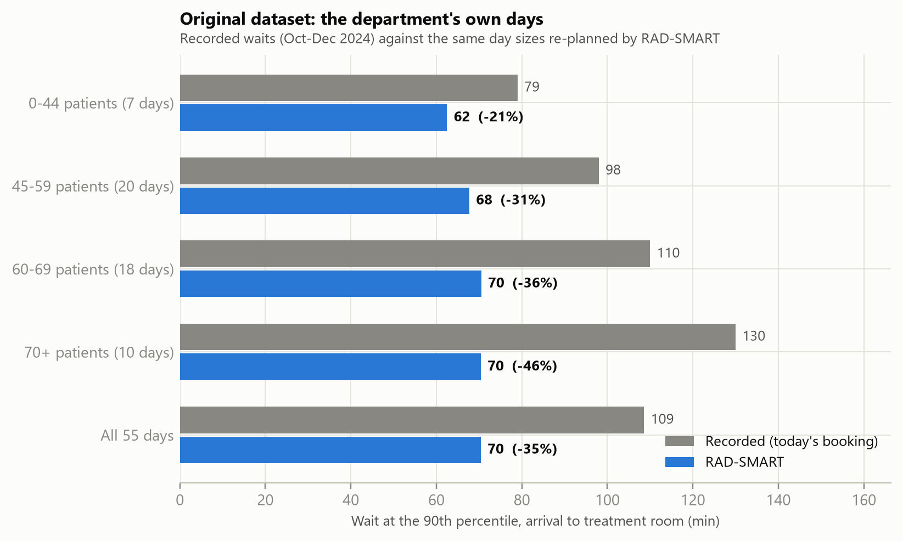
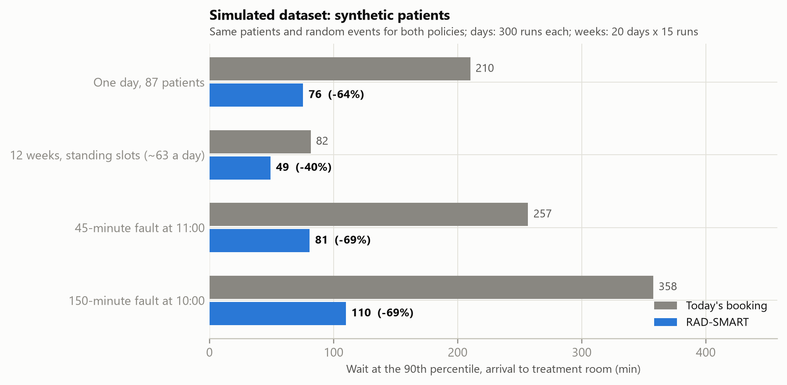

# RAD-SMART: Impact Analysis

**How much RAD-SMART improves waiting, with and without it, on the original and on the simulated dataset**

Health-a-thon 2026 · Cancer track · Use case 04: Clinic Operations & Patient Flow · 24 October 2026

> **Two datasets, kept apart.** The **original dataset** is the department's own record of 55 treatment days (October–December 2024, 3,137 patient-days), used only as aggregates. The **simulated dataset** is synthetic patients built on the department's rules. In both, "without" means today's way of booking and "with" means RAD-SMART. The wait is measured from arrival to entering the treatment room.

---

## 1. The answer in one table

| Dataset | Measure | Without RAD-SMART | With RAD-SMART | Change |
|---|---|---|---|---|
| Original (55 recorded days) | 90th-percentile wait | 108.6 min | **70.4 min** | **−35%** |
| Original (55 recorded days) | Treated more than 1 hour late | 22.2% | **5.7%** | −16.5 points |
| Simulated (12 weeks, standing slots) | 90th-percentile wait | 81.6 min | **49.3 min** | **−40%** |
| Simulated (12 weeks, standing slots) | Treated more than 1 hour late | 18.6% | **3.6%** | −15.0 points |

The 90th-percentile wait is the time that one patient in ten waits longer than: the long waits patients remember. The pilot's target is a cut of at least 25%; both datasets show more than that.

## 2. Original dataset: the department's own days

**Without** is what the department recorded. **With** is the same days re-planned by RAD-SMART in the digital twin: the same number of patients, arriving as early or as late as the records show for each hour of the day. We trust the twin because, when it replays today's booking, it gives a 90th-percentile wait of 106.1 minutes against the 108.6 recorded.

| Day size | Days | 90th-percentile wait, without → with | More than 1 hour late, without → with |
|---|---|---|---|
| Up to 44 patients | 7 | 79 → **62 min** (−21%) | 14.5% → **4.7%** |
| 45–59 patients | 20 | 98 → **68 min** (−31%) | 21.8% → **6.1%** |
| 60–69 patients | 18 | 110 → **70 min** (−36%) | 20.8% → **5.8%** |
| 70 or more patients | 10 | 130 → **70 min** (−46%) | 27.4% → **5.5%** |
| **All 55 days** | 55 | 108.6 → **70.4 min** (−35%) | 22.2% → **5.7%** |

Across all 55 days, the median wait goes from 34 to 30 minutes and the share treated within 15 minutes of the appointment from 28.9% to 49.5%.

{width=6.0}

**What this shows.** The busier the day, the bigger the gain: today the long waits grow with the size of the day, but with RAD-SMART they stay near 70 minutes. The median moves little because patients are still asked to come 20 minutes early (45 minutes for pelvic patients, to drink water).

**Caveat.** "With" is a replay in the digital twin, not a live trial. The 90-day pilot will measure it on real days.

<!-- pagebreak -->

## 3. Simulated dataset: synthetic patients

Synthetic patients follow the department's rules: new starts before 17:00, standing slots kept for the whole course, the blood-irradiation time, the hospice bus, public transport home by 21:00 and the shared breast board and ABC unit. Both ways of booking face the same patients and the same random events (late arrivals, overruns, urgent starts, imaging holds). A single day is run 300 times; the 12 weeks are 20 evaluation days, each run 15 times.

{width=6.4}

| Scenario | Median wait | 90th-percentile wait | Within ±15 min | More than 1 hour late |
|---|---|---|---|---|
| 12 weeks, standing slots (about 63 a day) | 40 → **20 min** | 82 → **49 min** (−40%) | 26% → **36%** | 19% → **4%** |
| One busy day, 87 patients | 133 → **36 min** | 210 → **76 min** (−64%) | 10% → **53%** | 66% → **6%** |
| 45-min breakdown at 11:00 | 177 → **37 min** | 257 → **81 min** (−69%) | 8% → **50%** | 74% → **8%** |
| 150-min breakdown at 10:00 | 280 → **39 min** | 358 → **110 min** (−69%) | 7% → **47%** | 83% → **14%** |

**The 12 weeks** is the fairest test, because the department keeps each patient's slot for the whole course. New patients arrive every working day and RAD-SMART gives each one a new-start slot before 17:00 and one standing slot that is free on every treatment date. No hard rule was broken on any day.

**The 87-patient day** is 10 more patients than the busiest recorded day. Today's way of booking gives too many patients the same time, so the queue builds all day.

**The breakdowns** follow the department's rules of 24 October:

- **45 minutes:** nobody is sent home. The machine is back at 11:45, everyone is treated today with 8 minutes of overtime, 38 patients get a new time (those not yet travelling are told before they leave home), and 1 new start moves to the next working day.
- **150 minutes:** the machine is back at 12:30. Everyone else is treated today with 50 minutes of overtime, 58 patients get a new time, 1 patient who had not left home is sent back (the fraction is added at the end of the course), and 2 new starts move to the next working day.

In both cases RAD-SMART re-planned in 10–14 seconds, the independent checker found no broken rule, and a technologist or doctor approves the response before anything changes.

## 4. What it costs

The gains are not free. In the 12 weeks:

- **The evening runs later.** The last patient finishes at about 00:07 instead of 21:55, still inside the department's hours (until about 01:00). Patients are spread out instead of being given the same time, and time before 17:00 is kept for new starts, so more patients are treated in the evening. About 6 patients a day who do not rely on public transport finish after 21:00.
- **Some new starts wait.** 22% of new patients start later than they would today, by 0.4 working days on average, because a standing slot must be free on every day of the course.
- **Preferred times are harder to give.** Patients who ask for a particular time are treated within 15 minutes of it 4% of the time, against 31% today. Today they are given the time they ask for but then wait in the queue; with standing slots the time must be free on every day of the course. A slot-change request moves them when a nearer slot frees up.
- **Overtime.** 8 minutes a day on average; up to 50 minutes on a breakdown day (the department's rule allows 60).

## 5. Bottom line

- **On the department's own days**, RAD-SMART cuts the 90th-percentile wait by 35% (108.6 → 70.4 minutes) and the share treated more than an hour late from 22% to 6%. The busiest days gain the most (−46%).
- **On synthetic weeks with standing slots**, it cuts the 90th-percentile wait by 40% (82 → 49 minutes), and on breakdown days by 69%.
- **The price** is a later evening, a short delay for one new start in five, fewer preferred times and a few minutes of overtime. The department decides whether that trade is worth it; the pilot measures it.

Figures and numbers come from `poc/run_poc.py`; see `poc/results/results.json` (sections `analysis`, `validation`, `weeks` and `disruption`).
