# RAD-SMART User Guide

**How to use the app in the department, and how to show it in a demo**

Health-a-thon 2026, Cancer track · Manipal · 25 October 2026

---

RAD-SMART plans the radiotherapy machine's day. It gives every course one fixed daily time that keeps all the department's rules, and it re-plans in seconds when the machine breaks down. It runs inside CARE, the hospital information system, as an extra button and eight pages, and each patient gets a page on their phone. Messages to patients are translated into their language by Sarvam AI, with a voice note. **RAD-SMART only suggests. A doctor or technologist approves every change.**

> **Watch the demo first.** A recording of the real app, narrated and captioned, is on the project website: [psraghothamrao8.github.io/RAD-SMART](https://psraghothamrao8.github.io/RAD-SMART/#demo). The file is also in the repository as `docs/media/RAD-SMART_demo.mp4`. Every patient in the video and in this guide is synthetic.

## Who does what

| Person | Uses RAD-SMART to | Pages |
|---|---|---|
| **Doctor** (radiation oncologist) | enter a course, approve its time, explain it in plain words | RADSMART button, New course, Courses |
| **Technologist** (RTT) | run the day: arrivals, time changes, breakdowns, messages to patients | Today, Courses, Breakdown, Messages |
| **Reception** | check patients in by scanning the code on their phone | Check-in |
| **Patient and family** | see their times and messages, and tell the department if they are late | their own phone page (no app, no login) |
| **Doctor and technologist** | see whether waits are falling | Insights |

A technologist can do everything except enter or approve a course. Only a doctor can do that.

## Part A · Everyday use

The steps below follow one patient and one working day, in the same order as the demo video.

### 1. The doctor plans a new course

1. Open the patient's visit in CARE and click the green **RADSMART** button at the top. The button shows the patient's daily time once a course is approved.

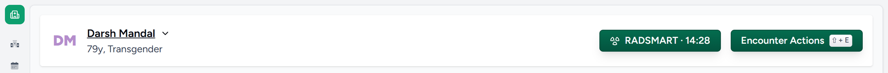{width=6.2}

2. The button opens the patient's radiotherapy courses. Click **New course**.
3. Fill in the prescription, as on the paper form: hospital number, diagnosis, total dose, number of fractions, treatment days, technique and site.
4. In the **priority checklist**, tick what matters for this patient: public transport, hospice bus, ABC or breast board, a time window, gap-sensitive course, a preferred part of the day (morning 08:30-12:00, afternoon 12:00-17:00 or evening 17:00-21:00), and so on. **Hard constraints** are always kept. **Soft goals** are met where possible. Some boxes tick themselves: age 70 or over ticks *older patient*, and the technique ticks its accessories.

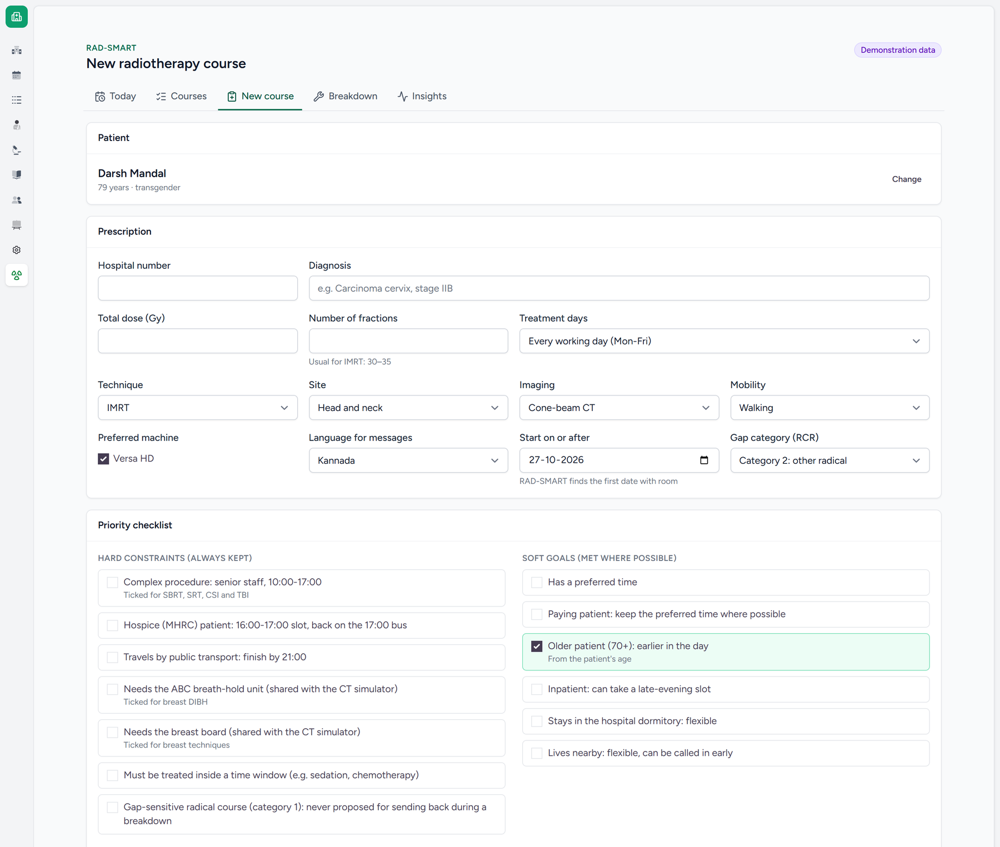{width=5.4}

5. Click **Save and propose slots**. Within seconds RAD-SMART proposes a **first day** (always finishing before 17:00) and **one standing time** for every later fraction. It lists its reasons and offers alternatives.
6. Pick the recommended time or an alternative. To see the reasons in plain words, click **Explain in plain words**: Sarvam AI writes two or three sentences in English and in the patient's language, using only RAD-SMART's own reasons. If the explanation mentions any time that is not in the plan, it is thrown away and RAD-SMART's reasons are shown instead.
7. Click **Approve course and slots**. The patient keeps this time every day until the course ends. To start on a different date, use **Try another start date** and **Propose again**.

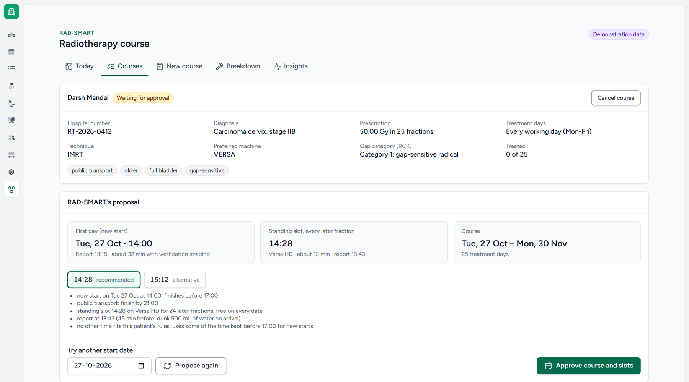{width=6.2}

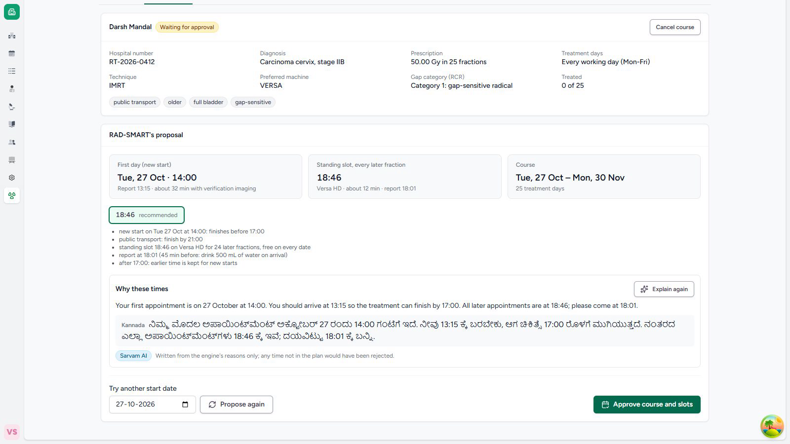{width=6.2}

8. After approval the course page shows **The patient's phone page**: a QR code, a six-letter check-in code and the patient's private link. Click **Send on WhatsApp** to send the link once, from the department's WhatsApp. The first message to the patient (their first day and daily time) is drafted on the **Messages** page.

### The patient's phone page

The patient opens the link on any phone. There is no app and no login, and the page shows the first name only. It is in the patient's language, with a switch to English. It shows:

- today's time to come, or the new time after a breakdown;
- the next five treatment days and their times;
- the department's messages, each with a voice note to play;
- on treatment days, the QR code and six letters to show at reception;
- four buttons: **I am on my way**, **I will be late** (15 to 60 minutes), **I cannot come today**, and **I want a different daily treatment time**, where the patient chooses morning, afternoon or evening. Nothing changes until staff decide; a patient can send at most six replies a day.

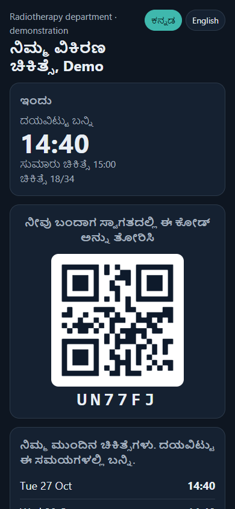{width=2.6}

### Reception checks patients in

Open **RAD-SMART → Check-in**. A USB barcode scanner types the code from the patient's phone into the box; or click **Scan with camera**; or type the six letters the patient reads out. Click **Check in**. The patient is marked arrived on Today's board, and any "on my way" or "late" reply is closed.

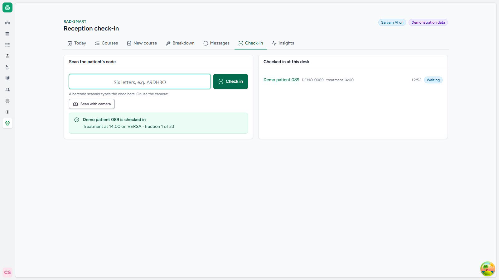{width=6.2}

### 2. The technologist runs the day

Open **RAD-SMART → Today**. The page shows four things:

- **The machine card:** sessions, new starts, how many are after 17:00, when the day will finish, and the free time left for new starts. Below them is the **live queue**: who is in the room, who to **call next**, how many are waiting, how many are past their time and not here yet, and whether the machine is on time or running behind.
- **The rule check:** a green bar means every hard rule holds for the patients still to be treated. **Approve the plan** records that a technologist or doctor has checked the day.
- **The timeline:** one block per patient. Green is a new start, blue is a standing slot, orange was moved today, violet is an added fraction. The red line is *now*.
- **The patient list:** each patient's time, reporting time, needs and status.

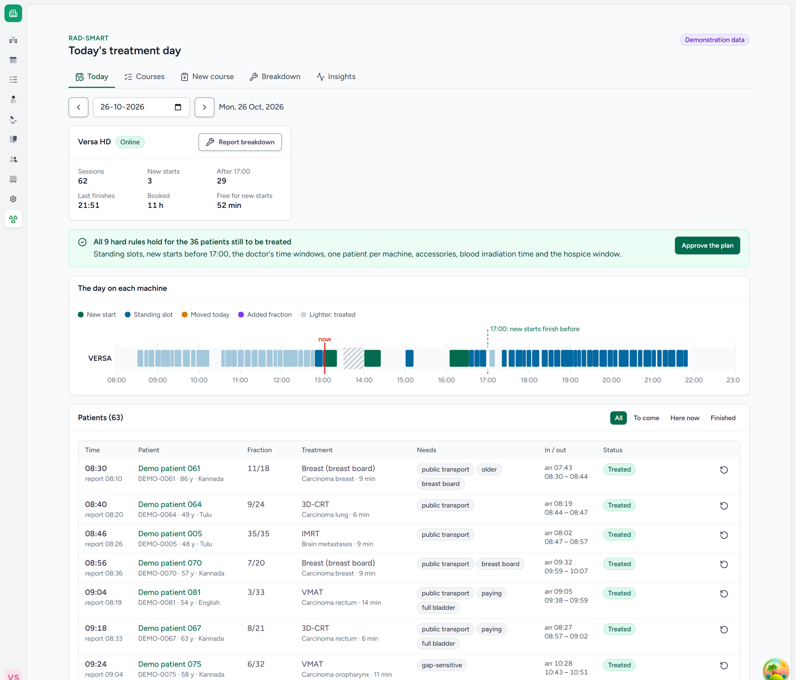{width=6.2}

For each patient, tap **Arrived** when they come, **In room** when they go in, and **Out** when they come out. These three taps measure the real waiting time. The other buttons:

- **Undo** corrects a wrong tap.
- **Not today** sends a patient home for the day, and adds the missed fraction at the end of the course.

**Patients come early and late, and the machine should not stand idle.** **Call next** is the first patient in the plan's order who is here and ready; anyone not here yet is skipped, not waited for, and goes next when they arrive. From 16:00 hospice patients come first, for the 17:00 bus. A patient past their time shows **Not here yet · N min past**, and one who arrived after their time in three of their last five visits shows **Often late**.

You can take anyone in at any time. When you tap **In room** for a patient ahead of others in the plan, RAD-SMART asks why, with one tap: **Came early**, **Next patient not here**, **Clinical reason**, **Other**, or just **Take in**. It never blocks you. It only reminds you of what to check: a full bladder not ready yet, a complex case before senior staff arrive at 10:00, or an ABC unit or breast board in use on another machine or at the CT simulator. The patient is marked **Out of turn**, with the reason and whom they went ahead of, and the plan for everyone else stays as it is.

**From patients' phones** lists what patients said today: on the way, late by about N minutes, cannot come, or asks for the morning, afternoon or evening. A badge also appears beside the patient. Click **Done** when it is handled. A request for another time also appears beside the patient and under the course, with RAD-SMART's proposal (step 3).

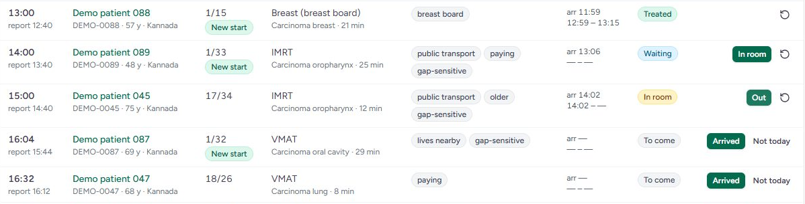{width=6.2}

### 3. The patient's preferred part of the day

Patients say **when** they would like to come (morning, afternoon or evening) rather than an exact minute. The doctor can record it at intake, and the patient can change it from their phone; staff can change it on the course page under **Part of the day**. When the patient states one, it replaces the "older patients earlier" rule.

A new patient often has to start wherever there is room. **As other courses finish and their slots free up, RAD-SMART looks for a better time** for each patient outside their preferred part of the day: a time inside it, on the same machine, free on every remaining treatment day, that keeps every rule and the time kept for new starts. When it finds one, the patient's row on **Today** shows **A morning slot is free: 09:18 every day from Wednesday. Ask the patient.**

- Ask the patient. If they agree, click **Patient agrees**: the new time starts on the date shown, and a message in their language is drafted on **Messages**.
- If they would rather stay, click **Prefers to stay**. RAD-SMART does not ask again unless their preference changes.
- Patients with the most fractions left, and furthest from their preferred time, are offered first. No two patients are offered the same slot, an offer is withdrawn if its slot is taken, and patients with three or fewer fractions left are not asked to change.

If the patient asks at the desk:

1. Open **Courses**, search for the patient by name or hospital number, and open the course.
2. Under **The patient asks for another time**, enter the date it should start from, what the patient asks for (morning, afternoon, evening, or an exact time), and the reason (for example, bus timing).
3. Click **Find a time**. RAD-SMART shows the nearest time that keeps every rule, for this patient and for everyone else. If nothing inside the part of the day is free yet, it says so, keeps the preference, and offers a time when one frees up.
4. Choose a time and click **Approve**, or **Keep** the current time. Nothing changes until someone approves.

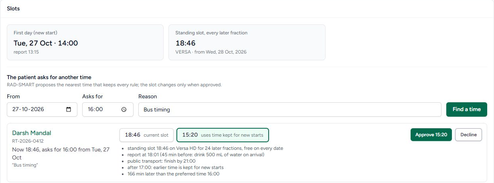{width=6.2}

### 4. The machine breaks down

1. On **Today**, click **Report breakdown**. Enter when the fault started, the engineer's estimate of the downtime (15 minutes to 48 hours) and a short note. Then click **Take offline and propose**.
2. Within seconds RAD-SMART proposes a new plan that follows the department's rules:
   - **Up to 1 hour:** nobody is sent home. Everyone is treated today, with up to an hour of overtime.
   - **Longer than 1 hour:** only as many patients are sent back as the downtime needs, starting with patients who have not yet left home. Their missed fraction is added at the end of the course. A gap-sensitive or hospice patient is never sent back automatically: the doctor decides.
   - **Patients still at home** are asked to come later, with a message drafted in their own language.
   - **New starts** wait for the machine and still finish before 17:00, or move to the next working day.
3. Read the summary and the list of affected patients, then click **Approve and notify**, or **Reject**.
4. If the engineer changes the estimate, choose the new time and click **Re-plan with this estimate**. When the machine works again, click **Back online**.

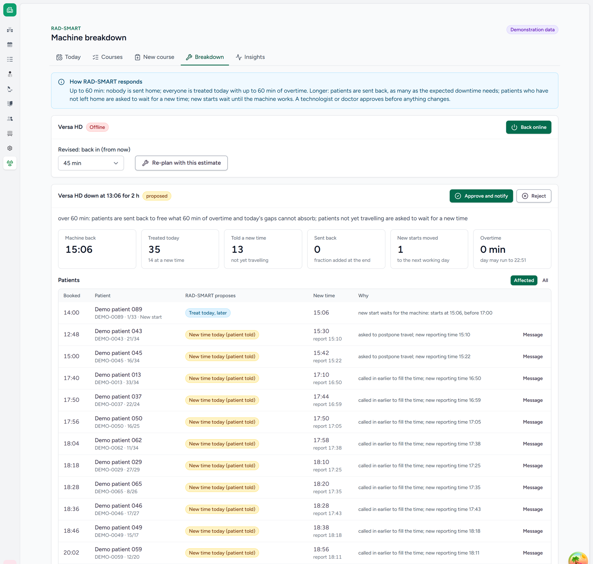{width=6.2}

### Messages to patients

After every approval (a new course, a new daily time, a breakdown response), RAD-SMART drafts a message for each patient it affects. Open **RAD-SMART → Messages**:

1. Each message shows the text in the patient's language and in English. Sarvam AI translates it; if the translation drops or changes any time, it is not used and the message goes in English.
2. Click **Listen** to hear the voice note in the patient's language (**English** for the English one).
3. Click **Open WhatsApp**. WhatsApp opens with the patient's number and the message filled in. Check it and press send there. **Copy** puts the text on the clipboard for SMS or any other app.
4. Click **Mark sent**. **Do not send** cancels a message that is no longer needed.

The patient also sees every message on their phone page, with the voice note.

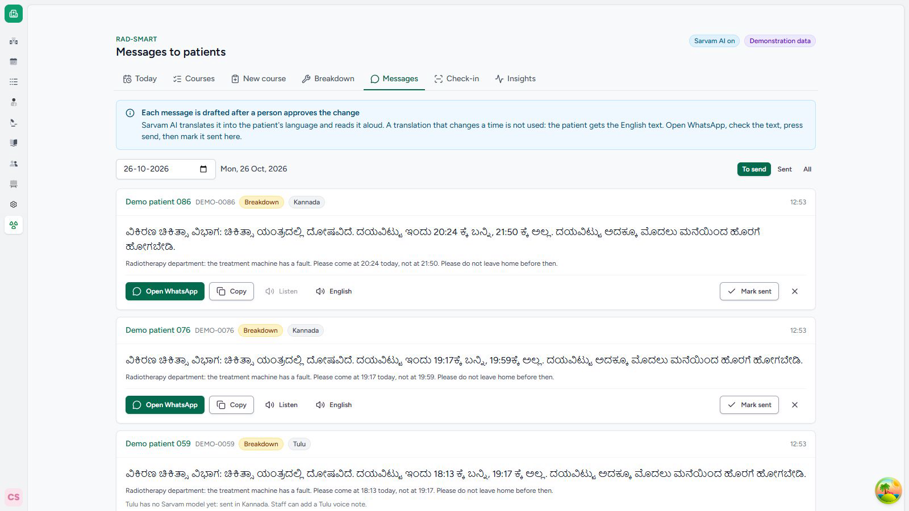{width=6.2}

### 5. Check that it is working

**Insights** shows the measured waits for any date range:

- the long wait (90th percentile) and the typical (median) wait, from arrival to the treatment room;
- the share of patients treated on time, and the share more than an hour late;
- patients sent back, new starts postponed, and fractions added at the end of courses.

The chart compares each day with the department's baseline (108.6 minutes) and the pilot target (25% lower).

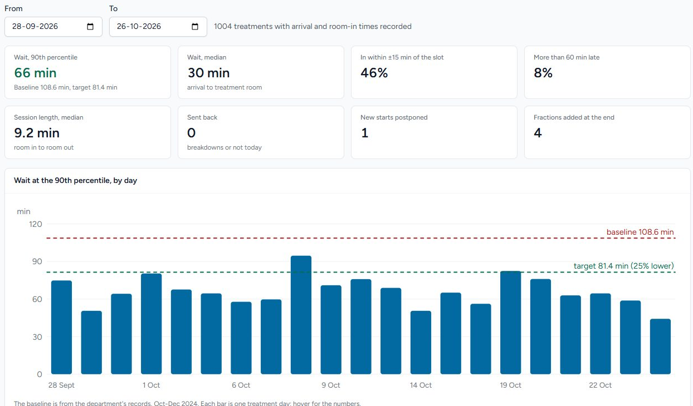{width=6.2}

### What RAD-SMART never does

- It never decides **whether** or **how** a patient is treated, only **when**.
- It never changes a time, sends a patient back or messages anyone without a person's approval. A technologist presses send on every WhatsApp message.
- It never sends names, hospital numbers or phone numbers to an AI service. Only the message text goes to Sarvam AI.
- It never uses a translation or an explanation that changes or invents a time.

<!-- pagebreak -->

## Part B · Showing it in a demo

### The quickest way: the online demonstration

Open https://radsmart.braveglacier-5f9807f7.uaenorth.azurecontainerapps.io/try/ in any browser. Click **Doctor**, **Reception**, **Technologist** or **Patient** to go straight in, with no password. Every patient is synthetic.

- If the department clock there is outside the working day, click **Start a fresh day at 10:30**. The page refreshes itself until the day is ready.
- To show a message arriving on a phone, open an approved course, scan its **Telegram (demonstration)** code with the phone and press START in the bot's chat. Then click **Send on Telegram** on the Messages page. The patient gets the text, the voice note and the reply buttons. In real use the same message goes by WhatsApp.
- Everyone who tries it shares the one demonstration. It starts again every morning at 05:30 IST.

### Before the demo on your own CARE (15 minutes)

1. Start the app as described in [app/README.md](https://github.com/psraghothamrao8/RAD-SMART/blob/main/app/README.md): the CARE backend, the RAD-SMART plugin and care_fe.
2. **Refresh the demonstration data** so today's board is played out up to the current time (command below). On a weekend or a holiday, the demo shows the next working day.
3. Open two browser windows, one normal and one private:
   - sign in as **care-doctor** in one, and open a patient's visit page;
   - sign in as **care-staff** in the other, and open **RAD-SMART → Today**.
4. Keep the demo video open in a third tab as a backup.
5. To show the patient's side, open the patient's page on a phone (or a narrow browser window) from **Open the page** on the course. Messages, voice notes and Explain need Sarvam AI: check that the header shows **Sarvam AI on**. Without it, everything still works in English.
6. Pick a patient with no radiotherapy course, so the RADSMART button starts a new course.

The refresh command, run in the CARE workspace:

```
./.agent/compose.sh exec backend python manage.py radsmart_demo --facility <facility id> --user care-doctor --census 60
```

### The 5-minute demo

| Time | Screen (who) | What to do | What to say |
|---|---|---|---|
| 0:00 | Visit page (doctor) | Point to **RADSMART**, click it, then **New course** | "RAD-SMART lives inside the hospital system. The doctor starts from the patient's visit." |
| 0:30 | New course | Fill in the prescription, then tick *public transport* and *gap-sensitive* | "The doctor fills the form as on paper. Each tick becomes a rule the computer must keep." |
| 1:15 | Proposal | Click **Save and propose slots**, point to the first day and the standing time, then **Approve** | "One time for the whole course, with the reasons. The doctor stays in charge." |
| 1:40 | Proposal (doctor) | **Explain in plain words**, then, after approving, point to the QR code and **Send on WhatsApp** | "Sarvam AI explains the time in the patient's language. Any invented time is thrown away." |
| 2:10 | Phone (patient) | Show the patient's page in Kannada; play the voice note; tap **I am on my way** | "No app, no login. The patient hears the message in their language." |
| 2:40 | Check-in (reception) | Type or scan the six-letter code | "Reception scans the phone. The board shows the patient waiting." |
| 3:00 | Today (technologist) | Show the rule check, the live queue (**Call next**, on time or behind) and **From patients' phones**; tap **In room**, **Out** | "Every rule holds. If the next patient is not here, the machine takes whoever is. These taps measure the real wait." |
| 3:30 | Breakdown | **Report breakdown**, 2 hours: show the summary, **Approve and notify**, then **Open messages**: **Listen**, **Open WhatsApp** | "A new plan in seconds, under the department's own rules. Every patient's message is drafted in their language." |
| 4:30 | Insights | Point to the long wait against the baseline and the target | "This is how the department will know if it works: 109 minutes today, target 25% lower." |

### If something goes wrong

- **A page is slow or fails:** switch to the video tab and keep talking over it. The video shows the same five steps.
- **The day looks finished or empty:** run the refresh command again (step 2 above).
- **A rule warning appears:** say so. It shows that RAD-SMART checks every plan. Then refresh the data after the demo.

### Questions the panel may ask

- **"Is this real patient data?"** No. All patients are synthetic. The department's records were used only as anonymised totals.
- **"What if the AI is wrong?"** The plan comes from an optimiser that cannot break a hard rule. A rule checker re-checks every plan, and a person approves every change.
- **"Does it work without internet?"** Planning, the rule check, the board and check-in run on the hospital's own server. Translation, voice notes and Explain need Sarvam AI over the internet; without it, messages go in English and staff see RAD-SMART's own reasons. Messages are sent from the department's WhatsApp.
- **"What if the translation is wrong?"** A translation that drops or changes a time is never used. In our test, 112 of 112 translations in four languages kept every time. (Sarvam has no Tulu model: Tulu speakers get Kannada, and staff can record a Tulu voice note.) Native speakers at the department rate every translation before the pilot.
- **"Where does it run? Is it production-ready?"** It is live on Microsoft Azure now, as one Docker image built on CARE's production image, with a managed PostgreSQL database and HTTPS, deployed by one script. The pilot runs the same image with demonstration mode off, on the hospital's own server or in an Indian Azure region, after the hospital's IT, data-protection and ethics approvals.
- **"What if a patient comes early, or is late?"** The technologist takes in whoever is ready. **Call next** skips anyone not here yet; taking a patient out of turn asks for a one-tap reason and is recorded, but is never blocked.
- **"Patients want the morning or the evening, not an exact time."** The doctor or the patient chooses morning, afternoon or evening. When a slot inside it frees up, RAD-SMART offers it to staff, who ask the patient before anything changes.
- **"What does staff have to do extra?"** Three taps per patient. The doctor fills in one form per course, which replaces the paper booking.

---

*RAD-SMART proposes; a doctor or technologist decides. It is not a medical device. The demo uses synthetic data only, online or on a local copy of CARE.*
